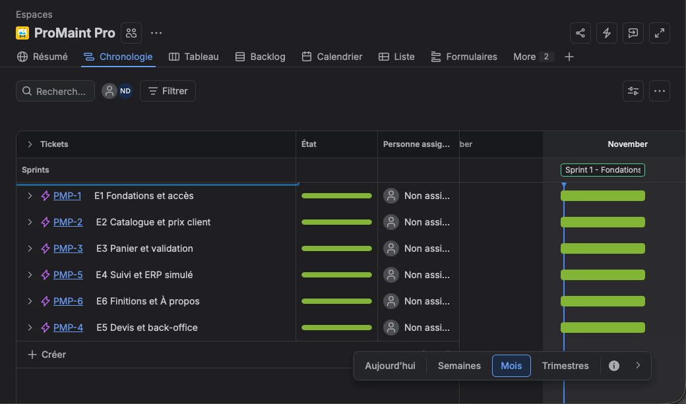

# ProMaint Pro — portail de commande B2B (projet fictif)

Un distributeur de pièces et consommables de maintenance reçoit ses commandes par e-mail, téléphone et PDF : quelqu'un les ressaisit à la main dans l'ERP, avec les erreurs de référence, de quantité et de prix que cela implique.
Le MVP : un client recommande en quelques secondes à ses prix négociés, avec validation au-delà d'un seuil, contrôle d'encours et transmission automatique à l'ERP — ni paiement par carte, ni marketplace.
La démarche : cadrage, puis règles de gestion et cas limites écrits et numérotés avant le code, prototype construit avec l'IA (Lovable), recette scénario par scénario à chaque étape.

**Site en ligne** : https://promaint-pro.lovable.app
**Document de cadrage** : https://claude.ai/artifact/FLmQAnv3TJ2geJZv4x5num#22b5214f-2829

## Comptes de démo

Aucune création de compte nécessaire : la page de connexion (https://promaint-pro.lovable.app/auth) propose des **boutons de connexion en un clic** par profil.

- Sélecteur « Tester en 2 minutes » : choisir un compte client (A, B ou C) puis un profil — acheteur, valideur ou admin ProMaint.
- Grille « Connexion en un clic » : les 7 comptes de démonstration, un bouton chacun.
- Liste « Comptes de démonstration » : libellé, e-mail et rôle pour chaque compte.

Mot de passe commun : `Demo1234!`

| Compte | Remise | Seuil de validation | Plafond d'encours | Profils |
| --- | --- | --- | --- | --- |
| Résidences Horizon | 0 % | 1 000 € HT | 5 000 € HT | acheteur, valideur |
| Clinique Saint-Aubin | 8 % | 1 000 € HT | 15 000 € HT | acheteur, valideur |
| Logistique Ouest | 12 % | 1 000 € HT | 30 000 € HT | acheteur, valideur |
| ProMaint (éditeur) | — | — | — | admin |

## Règles de gestion

| Code | Règle | Implémentation |
| --- | --- | --- |
| RG-01 | _À compléter depuis le document de cadrage (code jamais encodé dans l'app)._ | — |
| RG-02 | _À compléter depuis le document de cadrage (code jamais encodé dans l'app)._ | — |
| RG-03 | Prix = catalogue × (1 − remise compte), sauf prix contrat valide pour ce compte et ce produit : il prime. | `compute_price()` (base) + `getUnitPrice()` dans `src/lib/pricing.ts` |
| RG-04 | Entre une remise par palier de quantité et la remise compte, on garde la plus avantageuse, jamais les deux. | `getUnitPrice()` |
| RG-05 | Commande minimum 150 € HT, sinon 15 € de frais de traitement. | `fees()` + `place_order()` |
| RG-06 | Port offert à partir de 400 € HT, sinon 19 € de frais de port. | `fees()` + `place_order()` |
| RG-07 | Produit vendu par lot (12 ou 24) : la quantité est arrondie au multiple supérieur. | `roundToPack()` + `place_order()` |
| RG-08 | Au-delà du seuil de validation du compte, la commande part chez le valideur au lieu d'être validée seule. | `place_order()`, `decide_order()` |
| RG-09 | Si l'encours actuel ajouté à la commande dépasse le plafond du compte, la commande est bloquée et l'administrateur est alerté. | `place_order()`, `decide_order()` |
| RG-10 | Stock jamais affiché en quantité : « En stock », « Stock faible » (moins de 10) ou « Sur commande — délai X jours ». | `availability()` |
| RG-11 | _À compléter depuis le document de cadrage (code jamais encodé dans l'app)._ | — |
| RG-12 | Bouton « Demander un devis » au-delà de 5 000 € HT ou pour un produit vendu sur devis. | `needsQuote()`, `request_quote()` |
| RG-13 | L'admin chiffre le devis, valable 30 jours ; accepté, il devient une commande aux prix du devis ; expiré, il n'est plus acceptable. | `price_quote()`, `accept_quote()`, `quoteAcceptable()` |
| RG-14 | Case « J'accepte une livraison partielle » ; décochée, le délai affiché est celui de la ligne la plus longue. | `globalDelayDays()` |
| RG-15 | Cycle de vie : Brouillon → En attente de validation → Validée → Transmise ERP → En préparation → Expédiée → Livrée. | `src/routes/_authenticated/commandes.tsx` (frise de statut) |
| RG-16 | Références habituelles : produits commandés au moins 2 fois sur 12 mois, triés par fréquence, ajout au panier en un clic à la dernière quantité. | `habitualReferences()` dans `src/lib/habits.ts` |
| RG-17 | _À compléter depuis le document de cadrage (code jamais encodé dans l'app)._ | — |

## Cas limites

| Code | Cas limite | Implémentation |
| --- | --- | --- |
| CL-01 | À l'ouverture du panier, les prix sont recalculés et les lignes modifiées sont marquées « Prix mis à jour ». | `panier.tsx` (rechargement du catalogue), `priceChanged()` |
| CL-02 | Le contrôle de plafond passe avant la recherche d'un valideur : une commande hors encours n'est jamais proposée à validation. | `place_order()` |
| CL-03 | Si l'auteur de la commande est lui-même valideur, la commande est validée automatiquement. | `place_order()` |
| CL-04 | Lors de l'arrondi au lot, l'acheteur voit « Vendu par 12, quantité ajustée ». | `catalogue.tsx`, `panier.tsx` |
| CL-05 | Livraison partielle refusée : le délai global affiché est celui de la ligne la plus longue. | `globalDelayDays()` |
| CL-06 | Une référence arrêtée dans un devis accepté est signalée « Référence arrêtée » et bloque la transmission ERP jusqu'au remplacement. | `erp_transmit()`, `replace_order_line()` |
| CL-07 | Un double clic sur « Valider » ne crée qu'une seule commande. | `client_request_id` + verrou d'intransaction dans `place_order()` |
| CL-08 | Une panne ERP ne fait perdre aucune commande : statut « Validée » conservé, « En cours de transmission » côté client, 3 tentatives puis alerte admin. | `erp_transmit()`, table `events` |
| CL-09 | Annulation possible jusqu'à « Transmise ERP » incluse ; ensuite, « Contacter le service client ». | `cancel_order()` |
| CL-10 | Un produit éligible à la fois à un palier et à une remise compte : la meilleure s'applique, les deux ne se cumulent jamais. | `getUnitPrice()` |
| CL-11 | Sous 150 € HT, le montant manquant pour éviter les frais de traitement est affiché. | `fees()`, `panier.tsx` |
| CL-12 | _À compléter depuis le document de cadrage (code jamais encodé dans l'app)._ | — |

## Stack

- **React** + **TypeScript** (TanStack Start, rendu serveur et fonctions serveur)
- **Tailwind CSS** + composants shadcn/ui — interface sobre, type outil métier
- **Supabase** — authentification, base de données, sécurité par ligne (RLS), fonctions de calcul côté serveur
- Construit avec **Lovable**

Les calculs sensibles (prix, frais, statut d'une commande, transmission ERP) sont exécutés dans la base ; l'interface ne fait que les afficher. 28 tests unitaires couvrent les règles de prix, de panier et de références habituelles (`bunx vitest run`).

## Ce que j'ai corrigé dans le code produit par l'IA

> Une ligne par correction : ce que l'IA avait produit, ce que j'ai remis en cause, et où.

| # | Ce que l'IA avait produit | Ce que j'ai corrigé | Fichier / fonction |
| --- | --- | --- | --- |
| 1 | Le premier prompt demandait de créer 10 tables sans préciser leurs champs : Lovable s'est arrêté pour me demander quoi mettre. | J'ai spécifié chaque table, ses champs, ses statuts et la sécurité par ligne (RLS) : un client ne voit que les données de son compte. | Schéma Supabase (tables et politiques RLS) |
| 2 | La page « À propos du projet » prévue à l'étape 6 n'avait pas été créée, alors que l'étape était annoncée comme terminée. | Écart repéré en recette ; j'ai fait créer la page (problème, MVP, méthode, règles clés, lien vers le cadrage), accessible sans connexion. | Page À propos du projet + en-tête et pied de page |
| 3 | Le titre de l'accueil employait un registre familier (« pour pros ») pour un portail B2B. | Remplacé par « pour les professionnels », plus cohérent avec un outil métier. | Page d'accueil (titre principal) |
| 4 | La règle de prix devait être vérifiée par des tests, sans quoi rien ne prouvait que le prix contrat prime et que les remises ne se cumulent pas. | J'ai exigé des tests unitaires sur la fonction de prix et vérifié à la main les cas RG-03, RG-04 et CL-10 avec les comptes à 0 %, 8 % et 12 %. Les 28 tests passent. | Fonction de calcul du prix (getUnitPrice) et ses tests |

## Suivi du projet

Projet suivi sous Jira (Scrum) : 6 epics, 19 stories, 2 sprints clôturés. Chaque story reprend une règle de gestion ou un cas limite, avec son scénario de recette comme critère d'acceptation.

## Auteur

Projet conçu et prototypé par **Nicolas Dellery** — portfolio : https://nicolas-dellery-folio.lovable.app

Projet fictif réalisé par Nicolas Dellery — démonstration de démarche Product Builder. Aucune donnée réelle.
